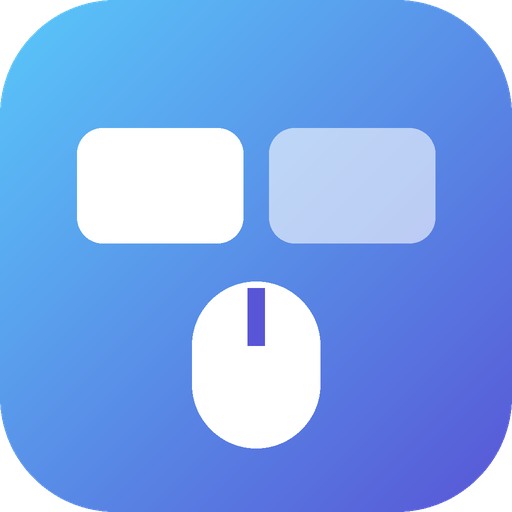
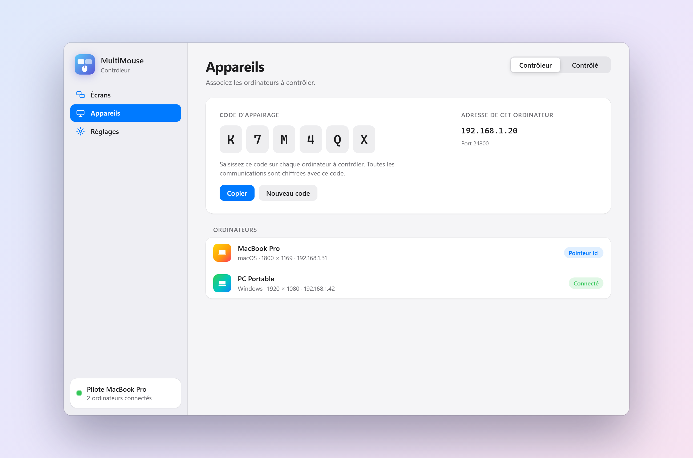
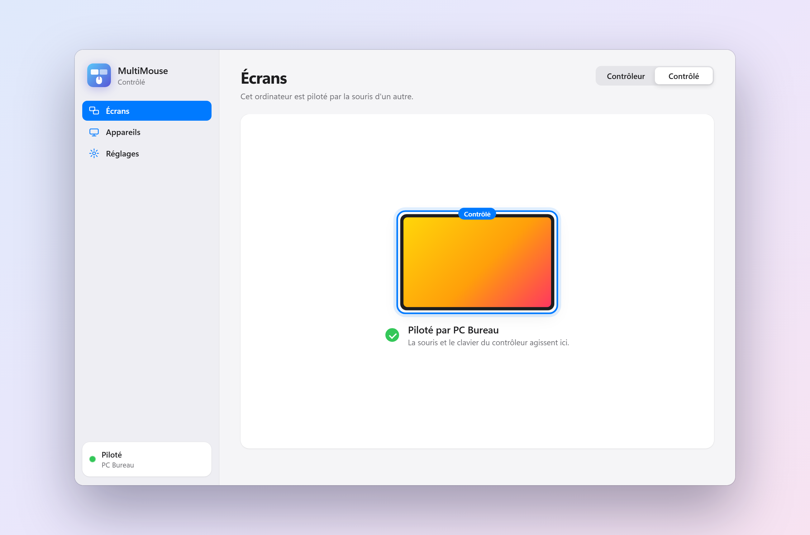
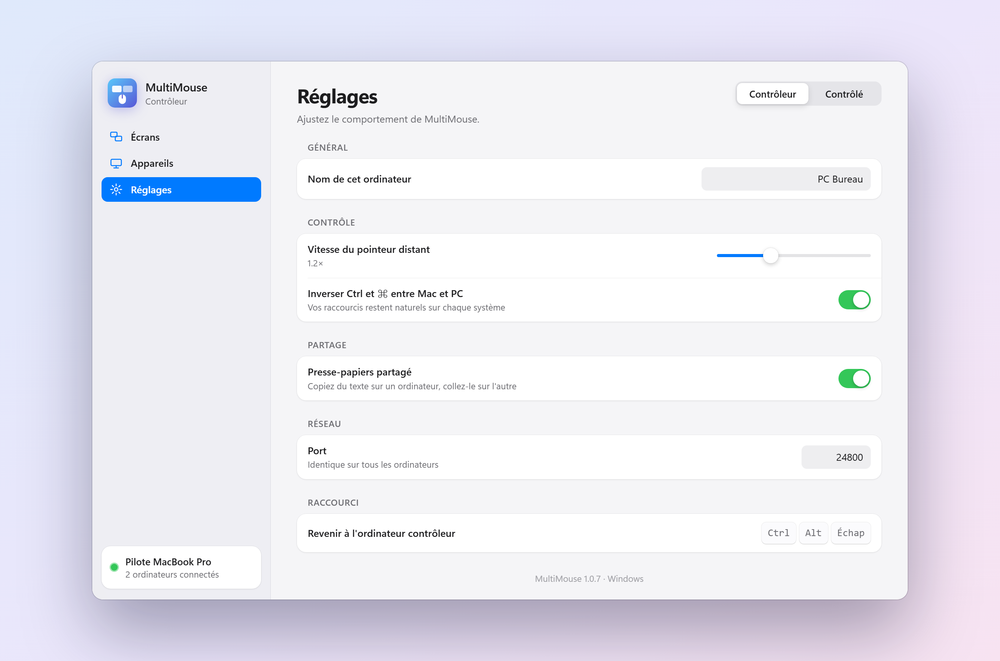

<p align="center">
  
</p>

<h1 align="center">MultiMouse</h1>

<p align="center">
  <b>Une souris, un clavier, tous vos ordinateurs.</b><br>
  Pilotez plusieurs PC et Mac sur le même réseau en glissant simplement le pointeur d'un écran à l'autre.
</p>

<p align="center">
  <a href="https://github.com/EfkaBz/MultiMouse/releases/latest"></a>
  
  
  
</p>

<p align="center">
  <a href="https://github.com/EfkaBz/MultiMouse/releases/latest"><b>⬇&nbsp;&nbsp;Télécharger MultiMouse</b></a>
</p>

<p align="center">
  <picture>
    <source media="(prefers-color-scheme: dark)" srcset="docs/captures/screens-dark.png">
    
  </picture>
</p>

---

## ✨ Fonctionnalités

| | |
|---|---|
| 🖥️ **Disposition visuelle** | Glissez vos ordinateurs pour reproduire votre bureau. Les écrans s'aimantent bord à bord et le multi-écran est pris en charge. |
| 🖱️ **Passage naturel** | Le pointeur passe d'un ordinateur à l'autre par les bords qui se touchent, sans raccourci ni bouton. |
| 🔀 **Windows et macOS** | Windows ↔ Windows, Windows ↔ Mac, Mac ↔ Mac. Ctrl et ⌘ sont inversés automatiquement entre PC et Mac. |
| ⌨️ **Clavier fidèle** | Les caractères sont transmis tels quels : AZERTY, QWERTY, AltGr et touches mortes fonctionnent même entre PC et Mac. |
| 📋 **Presse-papiers partagé** | Copiez du texte sur un ordinateur, collez-le sur l'autre. |
| 🔒 **Chiffré** | Toutes les communications sont chiffrées (AES-256-GCM) avec un code d'appairage. |
| 📡 **Zéro configuration** | Les ordinateurs se trouvent tout seuls sur le réseau local. |
| 🎨 **Interface épurée** | Thème clair et sombre automatique, animations discrètes. |

## 🚀 Démarrage en 3 étapes

1. **Installez** MultiMouse sur chaque ordinateur ([Windows : `MultiMouse-Setup.exe`, Mac : `MultiMouse.dmg`](https://github.com/EfkaBz/MultiMouse/releases/latest)).
2. Sur l'ordinateur qui a la souris, choisissez **Contrôleur**. Sur les autres, choisissez **Contrôlé** et saisissez le **code d'appairage** affiché par le contrôleur.
3. Dans **Écrans**, placez les ordinateurs comme sur votre bureau. C'est tout : amenez le pointeur au bord de l'écran.

> **Raccourci de secours** : <kbd>Ctrl</kbd> + <kbd>Alt</kbd> + <kbd>Échap</kbd> ramène toujours le pointeur sur l'ordinateur contrôleur.

## 📸 Aperçu

<table>
  <tr>
    <td width="50%" align="center">
      <picture>
        <source media="(prefers-color-scheme: dark)" srcset="docs/captures/devices-dark.png">
        
      </picture>
      <br><sub><b>Appareils</b> : code d'appairage et ordinateurs connectés</sub>
    </td>
    <td width="50%" align="center">
      <picture>
        <source media="(prefers-color-scheme: dark)" srcset="docs/captures/client-dark.png">
        
      </picture>
      <br><sub><b>Contrôlé</b> : un Mac piloté par la souris du PC</sub>
    </td>
  </tr>
  <tr>
    <td colspan="2" align="center">
      <picture>
        <source media="(prefers-color-scheme: dark)" srcset="docs/captures/settings-dark.png">
        
      </picture>
      <br><sub><b>Réglages</b> : vitesse du pointeur, Ctrl ↔ ⌘, presse-papiers</sub>
    </td>
  </tr>
</table>

## 💡 Bon à savoir

<details>
<summary><b>macOS : autorisations</b></summary>

<br>MultiMouse a besoin de deux autorisations dans **Réglages Système › Confidentialité et sécurité** :

- **Accessibilité** : pour déplacer le pointeur et taper au clavier sur ce Mac ;
- **Surveillance de l'entrée** : pour capter la souris et le clavier quand le Mac est contrôleur.

L'app n'est pas signée par un compte développeur Apple : au premier lancement, ouvrez-la avec clic droit › **Ouvrir**, ou via **Ouvrir quand même** dans Confidentialité et sécurité.
</details>

<details>
<summary><b>Réseau et pare-feu</b></summary>

<br>Les ordinateurs doivent être sur le même réseau local. MultiMouse utilise le port **TCP 24800** (contrôle) et **UDP 24801** (détection automatique). L'installateur Windows ouvre le pare-feu pour les réseaux privés. Si la détection automatique est bloquée, saisissez l'adresse IP du contrôleur dans l'onglet **Appareils**.
</details>

<details>
<summary><b>Sécurité</b></summary>

<br>Une clé de session est dérivée du code d'appairage (scrypt) et de valeurs aléatoires échangées à chaque connexion. Chaque message est ensuite chiffré et authentifié en AES-256-GCM : un ordinateur qui n'a pas le bon code est refusé avant de pouvoir envoyer le moindre événement. Le code ne circule jamais sur le réseau.
</details>

<details>
<summary><b>Limites actuelles</b></summary>

<br>

- On ne peut pas glisser un fichier d'un ordinateur à l'autre (pas de changement d'ordinateur bouton enfoncé).
- Le presse-papiers partagé transmet du texte uniquement.
</details>

## 🛠️ Développement

<details>
<summary><b>Lancer depuis les sources</b></summary>

<br>Python 3.10 ou plus récent.

```bash
python -m pip install -r requirements.txt
python -m multimouse
```
</details>

<details>
<summary><b>Compiler l'application et l'installateur</b></summary>

<br>

```bash
python -m pip install -r requirements.txt pyinstaller pillow
python build.py                 # dossier MultiMouse/ (Windows) ou MultiMouse.app (macOS) dans dist/
python build.py --installer     # + MultiMouse-Setup-x.y.z.exe (Windows, Inno Setup 6) ou MultiMouse-x.y.z.dmg (macOS)
python build.py --out <dossier> # résultats ailleurs que dans dist/
```

L'application macOS se compile sur un Mac. Une fois par Mac, lancez `sh tools/make_mac_cert.sh` : il crée le certificat « MultiMouse Code Signing » avec lequel `build.py` signe l'app, pour que macOS conserve les autorisations d'une version à l'autre.

Les captures de ce README se régénèrent avec `python tools/screenshots.py` (Chrome ou Edge requis).
</details>

<details>
<summary><b>Structure du projet</b></summary>

<br>

```
multimouse/
  app.py              fenêtre (pywebview) et pont JavaScript ↔ Python
  engine.py           contrôleur / contrôlé, disposition, passage d'un écran à l'autre
  platform_input.py   capture et injection souris / clavier (Windows, macOS)
  secure.py           canal TCP chiffré
  net.py              connexions, détection réseau
  config.py           réglages persistants
  ui/                 interface (HTML / CSS / JS)
  assets/             icônes
installer/            script Inno Setup (Windows), fond du .dmg (mac/)
tools/                icônes, fond du .dmg, certificat Mac, captures d'écran
docs/captures/     images de ce README
build.py              compilation
```
</details>
