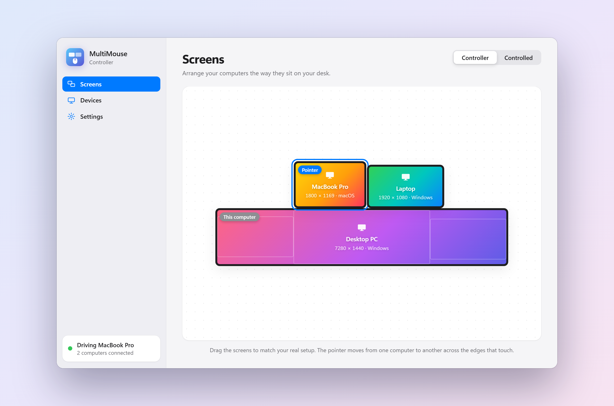
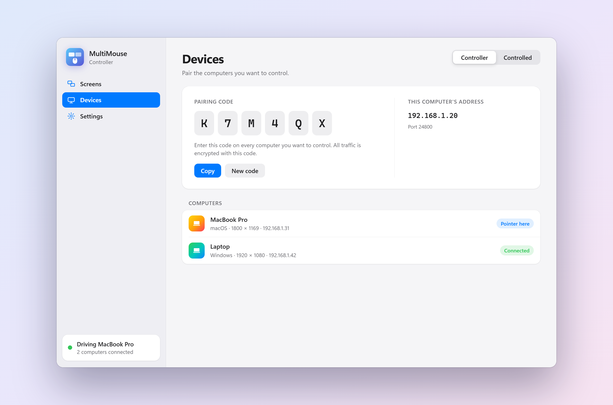
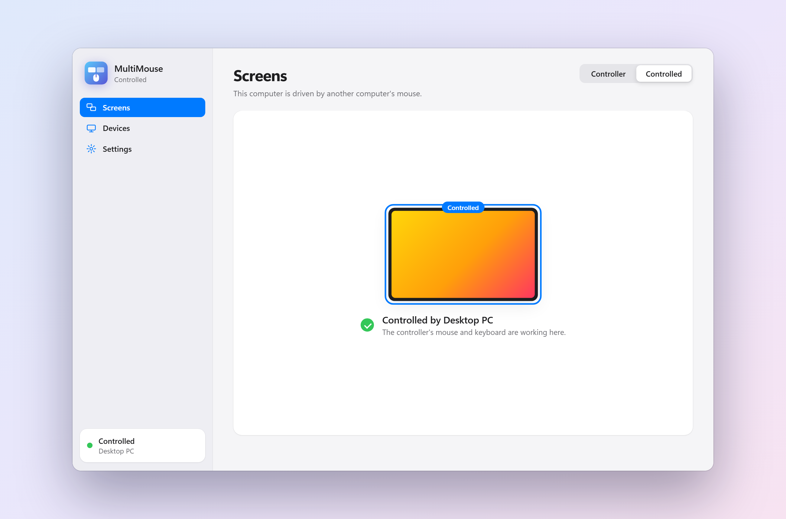
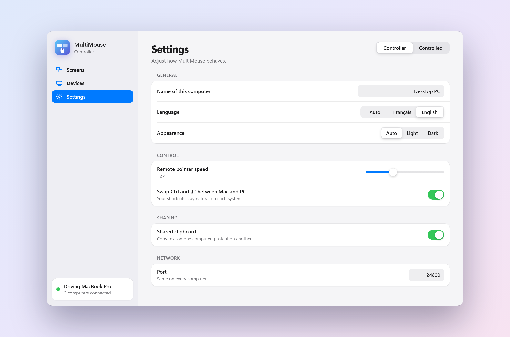

<p align="center">
  
</p>

<h1 align="center">MultiMouse</h1>

<p align="center">
  <b>🇬🇧 English</b> · <a href="README.fr.md">🇫🇷 Français</a>
</p>

<p align="center">
  <b>One mouse, one keyboard, all your computers.</b><br>
  Control several PCs and Macs on the same network by simply sliding the pointer from one screen to the next.
</p>

<p align="center">
  <a href="https://github.com/EfkaBz/MultiMouse/releases/latest"></a>
  
  
  
</p>

<p align="center">
  <a href="https://github.com/EfkaBz/MultiMouse/releases/latest"><b>⬇&nbsp;&nbsp;Download MultiMouse</b></a>
</p>

<p align="center">
  <picture>
    <source media="(prefers-color-scheme: dark)" srcset="docs/captures/en/screens-dark.png">
    
  </picture>
</p>

---

## ✨ Features

| | |
|---|---|
| 🖥️ **Visual layout** | Drag your computers to match your desk. Screens snap edge to edge, and multi-monitor setups are supported. |
| 🖱️ **Natural switching** | The pointer moves from one computer to another across the edges that touch, with no shortcut or button. |
| 🔀 **Windows and macOS** | Windows ↔ Windows, Windows ↔ Mac, Mac ↔ Mac. Ctrl and ⌘ are swapped automatically between PC and Mac. |
| ⌨️ **Faithful keyboard** | Characters are sent as typed: AZERTY, QWERTY, AltGr and dead keys work, even between PC and Mac. |
| 📋 **Shared clipboard** | Copy text on one computer, paste it on another. |
| 🔒 **Encrypted** | All traffic is encrypted (AES-256-GCM) with a pairing code. |
| 📡 **Zero configuration** | Computers find each other on the local network. |
| 🎨 **Clean interface** | English or French, light, dark or automatic theme, subtle animations. |

## 🚀 Get started in 3 steps

1. **Install** MultiMouse on every computer ([Windows: `MultiMouse-Setup.exe`, Mac: `MultiMouse.dmg`](https://github.com/EfkaBz/MultiMouse/releases/latest)).
2. On the computer with the mouse, choose **Controller**. On the others, choose **Controlled** and enter the **pairing code** shown by the controller.
3. In **Screens**, arrange the computers the way they sit on your desk. That's it: move the pointer to the edge of the screen.

> **Emergency shortcut**: <kbd>Ctrl</kbd> + <kbd>Alt</kbd> + <kbd>Esc</kbd> always brings the pointer back to the controller.

## 📸 Preview

<table>
  <tr>
    <td width="50%" align="center">
      <picture>
        <source media="(prefers-color-scheme: dark)" srcset="docs/captures/en/devices-dark.png">
        
      </picture>
      <br><sub><b>Devices</b>: pairing code and connected computers</sub>
    </td>
    <td width="50%" align="center">
      <picture>
        <source media="(prefers-color-scheme: dark)" srcset="docs/captures/en/client-dark.png">
        
      </picture>
      <br><sub><b>Controlled</b>: a Mac driven by the PC's mouse</sub>
    </td>
  </tr>
  <tr>
    <td colspan="2" align="center">
      <picture>
        <source media="(prefers-color-scheme: dark)" srcset="docs/captures/en/settings-dark.png">
        
      </picture>
      <br><sub><b>Settings</b>: language, theme, pointer speed, Ctrl ↔ ⌘, clipboard</sub>
    </td>
  </tr>
</table>

## 💡 Good to know

<details>
<summary><b>macOS: permissions</b></summary>

<br>MultiMouse needs two permissions in **System Settings › Privacy & Security**:

- **Accessibility**: to move the pointer and type on this Mac;
- **Input Monitoring**: to capture the mouse and keyboard when the Mac is the controller.

The app is not signed with an Apple developer account: the first time, open it with right-click › **Open**, or with **Open Anyway** in Privacy & Security.
</details>

<details>
<summary><b>Windows: administrator rights and antivirus</b></summary>

<br>Windows does not pass the mouse to a normal program while a window running as administrator is in front (Task Manager, an app started as administrator…). So that the pointer always switches, the installer creates a "MultiMouse" scheduled task that starts the app with administrator rights, without a confirmation prompt at each launch.

The installer is not digitally signed: Windows Defender or SmartScreen may flag it by mistake (automatic "!ml" detection). You can restore it from **Windows Security › Protection history**.
</details>

<details>
<summary><b>Network and firewall</b></summary>

<br>The computers must be on the same local network. MultiMouse uses port **TCP 24800** (control) and **UDP 24801** (automatic discovery). The Windows installer opens the firewall for private networks. If automatic discovery is blocked, enter the controller's IP address in the **Devices** tab.
</details>

<details>
<summary><b>Security</b></summary>

<br>A session key is derived from the pairing code (scrypt) and random values exchanged at each connection. Every message is then encrypted and authenticated with AES-256-GCM: a computer without the right code is refused before it can send a single event. The code never travels over the network.
</details>

<details>
<summary><b>Current limitations</b></summary>

<br>

- You can't drag a file from one computer to another (no switching while a button is held).
- The shared clipboard carries text only.
</details>

## 🛠️ Development

<details>
<summary><b>Run from source</b></summary>

<br>Python 3.10 or newer.

```bash
python -m pip install -r requirements.txt
python -m multimouse
```
</details>

<details>
<summary><b>Build the app and the installer</b></summary>

<br>

```bash
python -m pip install -r requirements.txt pyinstaller pillow
python build.py                 # MultiMouse/ folder (Windows) or MultiMouse.app (macOS) in dist/
python build.py --installer     # + MultiMouse-Setup-x.y.z.exe (Windows, Inno Setup 6) or MultiMouse-x.y.z.dmg (macOS)
python build.py --out <folder>  # output somewhere other than dist/
```

The macOS app is built on a Mac. Once per Mac, run `sh tools/make_mac_cert.sh`: it creates the "MultiMouse Code Signing" certificate that `build.py` signs the app with, so macOS keeps the permissions from one version to the next.

The README screenshots (English and French) are regenerated with `python tools/screenshots.py` (Chrome or Edge required).
</details>

<details>
<summary><b>Project layout</b></summary>

<br>

```
multimouse/
  app.py              window (pywebview) and JavaScript ↔ Python bridge
  engine.py           controller / controlled, layout, crossing from one screen to another
  platform_input.py   mouse / keyboard capture and injection (Windows, macOS)
  secure.py           encrypted TCP channel
  net.py              connections, network discovery
  config.py           persistent settings
  ui/                 interface (HTML / CSS / JS), English and French texts (i18n.js)
  assets/             icons
installer/            Inno Setup script (Windows), .dmg background (mac/)
tools/                icons, .dmg background, Mac certificate, screenshots
docs/captures/        README images (en/, fr/)
build.py              build
```
</details>
